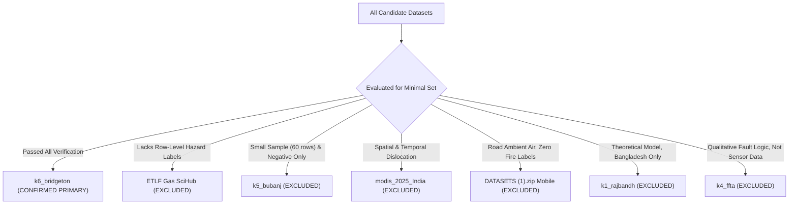

# Excluded Candidate Datasets: Technical Justification

**Project:** AI-Based Hazardous Gas Hotspot Detection and Fire Risk Prediction in Solid Waste Landfills  
**Execution Context:** Phase 8 Minimum Dataset Confirmation  
**Directory:** `Confirmed_Minimal_Datasets/manifests/`  
**Date:** October 2026  

---

## 1. Overview of Exclusion Policy

In strict accordance with supervisor instructions to **use a minimum number of datasets** and maintain publication-grade scientific validity:
- No dataset was included merely because it was examined in the earlier audit.
- No secondary dataset was merged if doing so would introduce spatial/temporal dislocation, unit confusion, or unlabelled noise.
- The `validation/` directory was deliberately left empty of secondary files because all candidate supporting datasets failed the requirements for an independent, label-compatible validation set.

---

## 2. Granular Evaluation of Examined Candidates

### Candidate 1: `ETLF Gas SciHub Final.xlsx`
- **Location:** Project Root (`ETLF Gas SciHub Final.xlsx`)
- **Examined Role:** Candidate independent validation dataset across 5 US Elevated Temperature Landfills.
- **Specific Reason for Exclusion:**
  1. **Absence of Unified Tabular Structure:** The file is an academic figure-plotting workbook split across 15 separate sheets (`Fig 2A`, `Fig 4A`, `Fig 5A`, `Fig 5B`, `Fig S1`, etc.). Individual gas and temperature measurements are partitioned into disjoint sheets with unaligned measurement indices, preventing direct row-wise feature vector construction.
  2. **Absence of Target Class Labels:** Unlike Bridgeton, individual measurement rows in ETLF do not have ground-truth `Risk_Category` labels. Sheet `Fig 6` only lists summary threshold ranges.
  3. **Site Anonymization:** Facility identities, geographical coordinates, and specific wellhead tags are legally withheld by EREF.
- **Scientific Verdict:** **EXCLUDED.** Merging or validating against ETLF would require ad-hoc synthetic re-labeling, introducing subjective bias.

---

### Candidate 2: `k5_bubanj_full_field_measurements_60_rows.xlsx`
- **Location:** `Datasets/datasets.zip -> datasets/k5_bubanj_full_field_measurements_60_rows.xlsx`
- **Examined Role:** Candidate cross-site European validation dataset.
- **Specific Reason for Exclusion:**
  1. **Statistically Insignificant Sample Size:** Contains only 60 total observations across 10 wells sampled over two months (May–June 2015).
  2. **Absence of Positive Hazard Labels:** All 60 rows represent stable, low-temperature baseline methanogenesis ($T \approx 28-31^\circ\text{C}$, $CO \approx 2\text{ ppm}$). There are zero elevated temperature cases and zero smoldering combustion events.
  3. **Absence of Ground-Truth Target Column:** Contains no `Risk_Category` label.
- **Scientific Verdict:** **EXCLUDED.** A 60-row negative-only dataset cannot validate a multi-class hazard model.

---

### Candidate 3: `modis_2025_India (1).csv`
- **Location:** Project Root (`modis_2025_India (1).csv`)
- **Examined Role:** Satellite thermal anomaly detection.
- **Specific Reason for Exclusion:**
  1. **Geographic and Temporal Dislocation:** Covers India during 2025; Bridgeton covers Missouri, USA during 2013–2016. Cannot be joined.
  2. **Thermal Contamination:** Coarse 1 km to 4.8 km pixels cover agricultural and forest fires. Less than 2% of detections coincide with waste sites.
  3. **Surface vs. Subsurface:** MODIS detects top-of-atmosphere surface fire radiative power ($FRP > 5\text{ MW}$), whereas landfill smoldering reactions occur 5–30 meters underground without open surface flame.
- **Scientific Verdict:** **EXCLUDED.** Completely incompatible with subsurface gas-thermal hazard prediction.

---

### Candidate 4: `DATASETS (1).zip` (Mobile Monitoring Transects)
- **Location:** `Datasets/DATASETS (1).zip`
- **Examined Role:** High-resolution atmospheric plume validation.
- **Specific Reason for Exclusion:**
  1. **Physical Domain Mismatch:** Measures ambient atmospheric downwind methane plumes (1.9 to 50 ppm) along public roads outside 5 New York landfills.
  2. **Zero Fire / Combustion Data:** Contains zero wellhead temperatures, zero internal gas ratios, and zero fire or reaction labels.
- **Scientific Verdict:** **EXCLUDED.** Measures fugitive atmospheric dispersion, not internal landfill combustion.

---

### Candidate 5: `k1_khulna_rajbandh_full_monthly_dataset_2000_2023.xlsx`
- **Location:** `Datasets/datasets.zip`
- **Examined Role:** Longitudinal multi-decadal dumpsite analysis.
- **Specific Reason for Exclusion:**
  1. **Different Environmental & Engineering Regime:** Unmanaged tropical open dumpsite in Bangladesh, completely different from an engineered sanitary landfill with gas extraction wells.
  2. **Calculated Rather than Measured Methane:** Methane values are theoretical IPCC First Order Decay estimates, not sensor measurements.
  3. **No Direct Fire Labels:** LST provides surface temperature, but no ground-truth fire incidence labels exist.
- **Scientific Verdict:** **EXCLUDED.**

---

### Candidate 6: `k4_complete_ffta_study_data.xlsx`
- **Location:** `Datasets/datasets.zip`
- **Examined Role:** Fuzzy Fault Tree Analysis.
- **Specific Reason for Exclusion:**
  1. **Non-Empirical Data:** Contains expert-elicited qualitative fault probabilities and minimal cut sets, not observational time-series measurements.
- **Scientific Verdict:** **EXCLUDED.** Serves as background literature context, not tabular training data.

---

### Candidate 7: Remote Sensing Catalogs (`Landfill_plume_detections.csv`, `landfilllmopdata.xlsx`, `GHGSat`, `Carbon Mapper`)
- **Examined Role:** Facility-scale methane super-emitter prediction.
- **Specific Reason for Exclusion from Primary Minimal Set:**
  1. **Supervisor Minimum Mandate:** The supervisor instructed the use of a minimum number of datasets focused on the core project objective.
  2. **Separation of Concerns:** These datasets address atmospheric plume venting, not subsurface fire risk. To avoid scope dilution, they are reserved as an optional secondary expansion rather than mixed into the core minimal dataset.
- **Scientific Verdict:** **EXCLUDED FROM MINIMAL CORE.** Preserved intact in `Datasets/` for optional secondary work.
