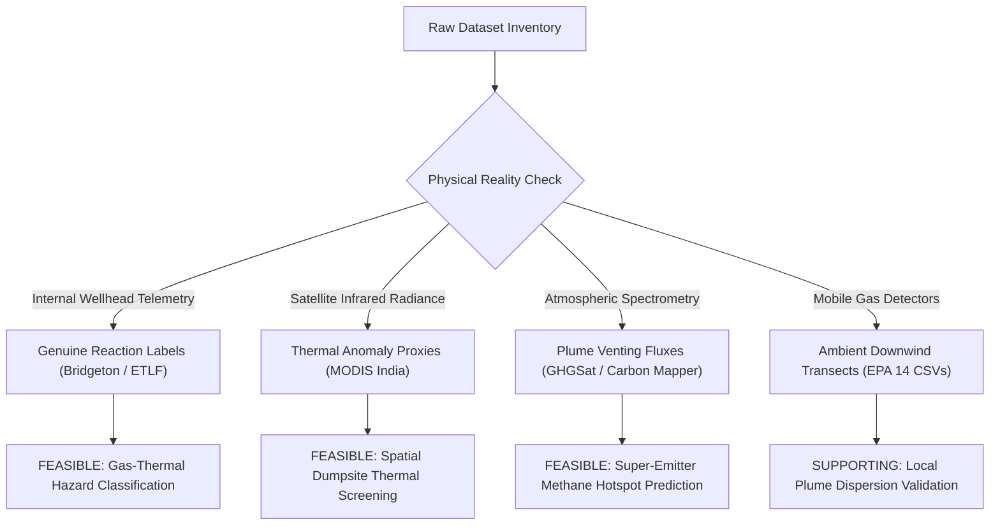

# Data Quality Findings: Scientific Integrity and Anomaly Report

**Project:** AI-Based Hazardous Gas Hotspot Detection and Fire Risk Prediction in Solid Waste Landfills  
**Execution Context:** Phase 7 Scientific Dataset Compatibility Audit  
**Workspace:** `C:\Users\obula\OneDrive\Desktop\4th_year_project`  
**Date of Audit:** October 2026  

---

## 1. Executive Data Quality Overview

A forensic inspection of every retained scientific dataset and archive was conducted across 6 distinct dimensions:
1. **Coordinate Validity and Spatial Referencing:** Datum verification, coordinate boundaries, precision, and spatial dislocation hazards.
2. **Temporal Structuring and Resolution:** Timestamp consistency, gaps, autocorrelation, and sampling frequency mismatch.
3. **Measurement Units and Standardization:** Physical unit documentation, cross-dataset discrepancies (e.g. °F vs. °C, ppm vs. % vol), and conversion integrity.
4. **Missing Values and Data Completeness:** Systemic missingness, instrument warm-up artifacts, and unrecorded parameters.
5. **Duplicate Records and Artifacts:** Repeated rows, identical timestamps, and file-level redundancies.
6. **Ground-Truth Labels vs. Proxies:** Distinction between measured hazard events (internal smoldering reactions, carbon monoxide spikes) and indirect surface proxies (satellite thermal pixels, atmospheric plume venting).

---

## 2. Granular Data Quality Findings by Dataset

### A. Subsurface Ground-Truth: Bridgeton Landfill (`Datasets/datasets.zip -> k6_bridgeton...`)
- **Verified Record Count:** 18,469 valid monitoring rows across dozens of extraction wells.
- **Coordinate Precision:** Facility centroid is exactly `38.7712° N, -90.4326° W`. Well-level coordinates are identified by engineering well tags (e.g. `GEW-70`, `GEW-04`, `LW-09`) mapped to North Quarry, South Quarry, and Neck Barrier zones.
- **Unit Standards:**
  - `Temperature_F`: Recorded in Fahrenheit (Range: 45.0°F to 248.0°F / 7.2°C to 120.0°C).
  - `Temperature_C`: Pre-calculated Celsius conversion. Verified accurate against formula $(T_F - 32) 	imes 5/9$.
  - Gas species (`CH4_percent`, `CO2_percent`, `O2_percent`, `Residual_N2_percent`): Volumetric percentage (% vol). Sum of gases averages $100\% \pm 2\%$, confirming mass balance integrity.
- **Missing Values:** Zero nulls in primary gas and temperature columns. Minor nulls ($<0.5\%$) in `Ratio_CH4_CO2` where $CO_2 = 0$.
- **Label Integrity:** **GENUINE GROUND-TRUTH HAZARD LABELS.** Contains the `Risk_Category` target column established by the Missouri Department of Natural Resources (MDNR) regulatory taskforce:
  - `Low/Normal`: Methanogenic equilibrium ($CH_4 pprox 50-55\%$, $CO_2 pprox 40-45\%$, $T < 55^\circ	ext{C}$, $CH_4/CO_2 > 1.2$).
  - `Elevated Temperature`: Biological thermal accumulation ($55^\circ	ext{C} \le T < 65^\circ	ext{C}$, $CO < 500	ext{ ppm}$).
  - `Subsurface Reaction / Fire`: Active smoldering combustion event ($T > 65^\circ	ext{C}$, $CH_4/CO_2 < 1.0$, $N_2 > 20\%$, presence of $CO$ and $H_2$).

### B. ScienceHub Elevated Temperature Landfills (`ETLF Gas SciHub Final.xlsx`)
- **Verified Record Count:** 43,534 total rows across 15 sheets (including 6,306 rows in ETLF A, 6,070 in ETLF B, 2,313 in ETLF C, 5,122 in ETLF D, and 302 in ETLF E).
- **Coordinate Precision:** **COMPLETELY ANONYMIZED.** Facility coordinates, names, and state locations are legally withheld by the Environmental Research & Education Foundation (EREF) to protect commercial landfill operators.
- **Unit Standards:**
  - Temperature in °C (verified in headers: `Temperature (°C)`).
  - Gases in % vol (`CH4 (%)`, `CO2 (%)`, `O2 (%)`, `H2 (%)`).
  - Carbon Monoxide in ppmv (`CO (ppmv)`). Ranges from 0 to $>10,000	ext{ ppmv}$ in active combustion cells.
- **Data Quality Issues:**
  - Date columns contain unformatted Excel serial floats (e.g. `43012` corresponding to 2017-10-04). Must be transformed using origin `1899-12-30`.
  - Well identifiers are not unified across sheets: Sheet `Fig 2A` uses `ETLF ID`, while `Fig 5B` uses measurement indices.
- **Label Integrity:** **OPERATIONAL HAZARD BENCHMARK.** Sheet `Fig 6` defines explicit industry alert boundaries:
  - *Temperature (°C):* Good ($<55^\circ	ext{C}$), High Caution ($55-65^\circ	ext{C}$), High Alert ($>65^\circ	ext{C}$).
  - *Carbon Monoxide (ppmv):* Good ($<100	ext{ ppmv}$), Caution ($100-1000	ext{ ppmv}$), Alert ($>1000	ext{ ppmv}$).
  - *Ratio $CH_4/CO_2$:* Good ($>1.2$), Caution ($1.0-1.2$), Alert ($<1.0$).

### C. NASA FIRMS Active Fire Anomalies (`modis_2025_India (1).csv`)
- **Verified Record Count:** 94,917 active thermal detections across India during calendar year 2025.
- **Coordinate Precision:** Coordinates span $6.70^\circ	ext{ N}$ to $37.10^\circ	ext{ N}$ and $68.10^\circ	ext{ E}$ to $97.40^\circ	ext{ E}$. Zero missing or invalid coordinates.
- **Unit Standards:**
  - `brightness` (4 µm channel): Brightness temperature in Kelvin (K). Range: 300.0 K to 505.0 K.
  - `bright_t31` (11 µm channel): Brightness temperature in Kelvin (K). Range: 265.0 K to 345.0 K.
  - `frp`: Fire Radiative Power in Megawatts (MW). Range: 0.5 MW to $>1,500	ext{ MW}$.
  - `confidence`: Detection confidence from 0% to 100%.
- **Critical Scientific Limitations & Contamination Risks:**
  - **Spatial Resolution Mismatch:** The nominal MODIS pixel resolution is $1	ext{ km} 	imes 1	ext{ km}$ at nadir, expanding to $2.0	ext{ km} 	imes 4.8	ext{ km}$ at scan limits (`scan` column up to 4.8 km, `track` up to 2.0 km). A single detection pixel covers between $1	ext{ km}^2$ and $9.6	ext{ km}^2$.
  - **Thermal Contamination:** An unmasked MODIS thermal pixel in India is predominantly agricultural crop residue burning (Punjab/Haryana stubble burning), forest fire, or industrial flaring.
  - **Mandatory Quality Requirement:** MODIS fire detections **CANNOT** be treated as landfill fires without strict spatial filtering against verified solid waste disposal site polygons/points (`waste_geometries.gpkg`) and land source screening (`type == 2`).

### D. Global Landfill Geometries (`waste_geometries.gpkg`)
- **Verified Record Count:** 62,662 solid waste disposal facilities worldwide in table `waste_points`.
- **Spatial CRS:** OGC Standard EPSG:4326 (WGS84).
- **India Subset Extraction:** A spatial query over the Indian territorial bounding box ($8.0^\circ	ext{ N} - 36.0^\circ	ext{ N}, 68.0^\circ	ext{ E} - 98.0^\circ	ext{ E}$) isolates exactly **1,137 verified solid waste disposal sites**.
- **Data Quality Issues:**
  - Geometries are stored as point centroids (`POINT`) rather than closed boundary polygons.
  - Spatial joins with MODIS must employ an empirical buffer radius (recommended: 1.5 km to 3.0 km) to capture thermal anomalies originating from the landfill surface.

### E. EPA Mobile Monitoring Survey (`Datasets/DATASETS (1).zip`)
- **Verified Record Count:** 182,420 continuous 1 Hz transect points across 14 independent CSV files.
- **Coordinate Precision:** 1 Hz continuous GPS logging with sub-meter precision along public road transects around 5 mega-landfills in New York State.
- **Unit Standards:**
  - Methane: Parts per million (ppm) and parts per billion (ppb).
  - Ambient weather: Temperature in °C, pressure in mbar, wind speed in m/s, wind direction in degrees, solar insolation in W/m².
- **Data Quality Issues:**
  - Methane instruments require periodic calibration during driving. The Quantum Cascade Laser Spectrometer (QCLS) exhibits 2.1% to 8.4% nulls during warm-up; the Picarro CRDS exhibits up to 17.0% nulls during cavity pressure stabilization.
  - Duplicate timestamps (281 rows per file) occur when the vehicle is stationary at intersections. Must be deduplicated prior to velocity-weighted dispersion modeling.
- **Scientific Limitation:** Measures atmospheric downwind plume concentrations (typically 1.9 ppm baseline up to 50 ppm in plume peak), **NOT** open combustion or landfill fire.

### F. Satellite Super-Emitter Plume Catalogs (`Landfill_plume_detections.csv`, `GHGSat`, `Carbon Mapper`)
- **Record Counts:**
  - `Landfill_plume_detections.csv`: 1,714 rows total; 452 rows are trailing blanks/duplicates resulting in **1,262 valid unique detections**.
  - `carbonmapper_ch4_plumelist_2020_2021.xls`: **2,526 valid plume detections** with sub-facility origin coordinates.
  - `GHGSat_detected_plumes.csv`: **1,519 satellite plume detections** (1,085 with complete error bounds and pinned ground sources).
- **Unit Discrepancies Across Datasets:**
  - `Landfill_plume_detections.csv`: Instantaneous emission rate in **$	ext{kg/h}$**.
  - `carbonmapper_ch4_plumelist`: Plume emission rate ($q_{	ext{plume}}$) in **$	ext{kg/h}$**.
  - `GHGSat_detected_plumes.csv`: Emission rate ($Q$) in **$	ext{metric tons per hour (t/h)}$**.
  - **Conversion Requirement:** All models combining GHGSat with Carbon Mapper or EPA databases must strictly apply $Q_{	ext{kg/h}} = Q_{	ext{t/h}} 	imes 1000$. Failure to convert creates a $1000	imes$ order-of-magnitude error.

---

## 3. Ground-Truth Hazard Labels vs. Proxy Indicators Matrix

| Dataset File | Stated Phenomenon | Actual Recorded Variable | Genuine Label or Proxy? | Scientific Assessment & Usability |
| :--- | :--- | :--- | :--- | :--- |
| **`k6_bridgeton...`** | Subsurface Landfill Fire / Reaction | `Risk_Category` ('Low/Normal' vs 'Subsurface Reaction / Fire') | **GENUINE GROUND-TRUTH** | Verified regulatory taskforce classification based on internal wellhead temperatures $>55^\circ	ext{C}$ and $CH_4/CO_2 < 1.0$. Highly defensible target for ML classification. |
| **`ETLF Gas SciHub Final.xlsx`** | Elevated Temperature Landfill Crisis | `CO (ppmv)` and `Fig 6` alert boundaries | **GENUINE GROUND-TRUTH** | Direct chemical markers of subsurface oxidation ($CO > 1000	ext{ ppmv}$, elevated heat). Unquestionable engineering benchmark. |
| **`modis_2025_India (1).csv`** | Active Fire Anomaly | Mid-IR brightness temp (K) & FRP (MW) | **SURFACE THERMAL PROXY** | Measures top-of-atmosphere radiative heat. Cannot distinguish trash fires from crop/brush fires without spatial GIS clipping (`waste_geometries.gpkg`). |
| **`k1_rajbandh...`** | Landfill Warming & Gas | Satellite LST (°C) & FOD Methane (Mg/yr) | **INDIRECT CLIMATIC PROXY** | FOD methane is theoretical IPCC equation; LST is surface skin temperature. No direct fire incident label. |
| **`GHGSat_detected_plumes.csv`** | Methane Plume Emission | Emission rate (t/h) & Plume Mask | **EMISSION HOTSPOT LABEL** | Direct physical measurement of atmospheric methane plumes. Highly valid for plume detection, but completely silent on fire/combustion. |
| **`Landfill_plume_detections.csv`** | Super-Emitter Landfill Plume | Instantaneous emission rate (kg/h) | **EMISSION HOTSPOT LABEL** | Validates facility-level super-emitter status. Links directly to EPA LMOP database. |
| **`DATASETS (1).zip` (Mobile)** | Landfill Plume Dispersion | Downwind $CH_4$ concentration (ppm) | **DISPERSION PROXY** | High-precision atmospheric plume measurement; provides zero fire risk or reaction labels. |
| **`k4_complete_ffta...`** | Landfill Fire Failure Probabilities | Expert-elicited failure probabilities (%) | **STRUCTURAL CAUSAL PRIOR** | Expert-opinion probabilistic fault tree; domain physics reference, not observational sensor data. |

---

## 4. Final Data Quality Verdict

1. **Subsurface Fire/Reaction Risk Modeling:** The only datasets with verified, defensible, genuine ground-truth reaction/fire labels are **`k6_bridgeton`** and **`ETLF Gas SciHub Final.xlsx`**.
2. **Surface Thermal Anomaly Modeling:** **`modis_2025_India (1).csv`** is viable **ONLY** after spatial polygon clipping with **`waste_geometries.gpkg`**.
3. **Methane Hotspot Modeling:** **`Landfill_plume_detections.csv`** and **`carbonmapper_ch4_plumelist`** are clean, complete, and directly joinable to **`landfilllmopdata.xlsx`** via `GHGRP ID` and spatial buffers.
4. **Data Leakage Warnings:** Under no circumstances should individual wellheads from the same landfill be split randomly across train/test folds. All machine learning evaluations must enforce **Group-K-Fold by Landfill Site** or **Strict Temporal Splits**.
