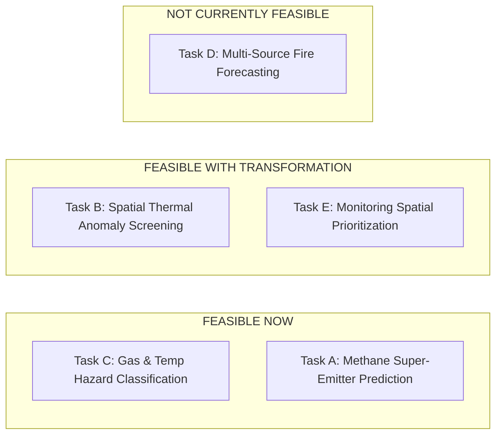

# Feasible Modelling Tasks: Evidence-Based Evaluation

**Project:** AI-Based Hazardous Gas Hotspot Detection and Fire Risk Prediction in Solid Waste Landfills  
**Audit Phase:** Phase 7 Scientific Dataset Compatibility Audit  
**Author:** Environmental Data Science & Machine Learning Research Team  

---

## 1. Overview of Evaluated Tasks

The master research plan proposed five potential research modeling tasks. Each task was rigorously evaluated against the verified schemas, sample sizes, target labels, and potential leakage risks of the retained datasets.

---

## 2. Detailed Task-by-Task Evaluation

---

### Task A: Methane Hotspot Super-Emitter Detection & Prediction
*Objective:* Predict whether a landfill will exhibit localized high-emission methane plumes ($>100	ext{ kg/h}$ or $>1	ext{ t/h}$) and estimate plume magnitude from facility operational and atmospheric characteristics.

- **Required Target Variable:**
  - Binary classification: Super-emitter plume occurrence ($	ext{Plume} \ge 100	ext{ kg/h}$ vs. No plume / below detection limit).
  - Continuous regression: Instantaneous methane emission flux ($	ext{kg/h}$).
- **Available Features:**
  - From `landfilllmopdata.xlsx`: Waste-in-place (tons), operating status (Open/Closed), landfill gas collection system installed (Yes/No), flare system capacity (scfm), landfill surface area (acres), depth (ft).
  - From satellite overpass records (`landfills_hyper_obs.xlsx`, `GHGSat`): Overpass cloud cover, sensor zenith angle, local wind speed (m/s).
- **Usable Labelled Examples:**
  - **1,262 valid plume detections** from `Landfill_plume_detections.csv` joined to LMOP facilities.
  - **2,526 plume detections** from `carbonmapper_ch4_plumelist_2020_2021.xls`.
  - **1,519 satellite plume observations** from `GHGSat_detected_plumes.csv`.
  - **81 global audited landfills** in `landfills_hyper_obs.xlsx` with binary plume flags (`plume(emit)`, `plume(enmap)`, `plume(prisma)`).
- **Suitable Evaluation Strategy:**
  - **Group-K-Fold by Facility (`GHGRP ID`):** Critical to prevent spatial data leakage. Plumes originating from the same landfill across different flight days must strictly reside within the same fold (either train or test, never both).
- **Data Leakage Risks:**
  - High risk if repeated overpasses of the same facility are randomly split. Solved by grouping on facility ID.
- **Major Limitations:**
  - Snapshot bias: Airborne/satellite overpasses represent a single 1-second instantaneous snapshot during clear-sky conditions (mostly midday 10:00-14:00 local time). Does not capture nighttime venting or diurnal variability.
- **Feasibility Verdict:** **FEASIBLE NOW.**  
  *Readiness:* Complete tabular data ready for immediate merging (`Landfill_plume_detections.csv` $\leftrightarrow$ `landfilllmopdata.xlsx`).

---

### Task B: Thermal Anomaly Detection or Screening at Landfill Sites
*Objective:* Detect, screen, and classify surface thermal anomalies and active heat hotspots located within or immediately adjacent to solid waste landfill boundaries.

- **Required Target Variable:**
  - Binary label: Landfill Thermal Anomaly Occurrence ($	ext{Anomaly} \in \{0, 1\}$).
  - Severity metric: Fire Radiative Power ($	ext{FRP}$ in MW) and brightness temperature difference ($\Delta T = T_{4\mu m} - T_{11\mu m}$).
- **Available Features:**
  - From `modis_2025_India (1).csv`: 4 µm brightness temperature ($T_{b4}$), 11 µm brightness temperature ($T_{b31}$), Fire Radiative Power (FRP), scan angle, day/night pass flag, detection confidence (0-100%).
  - From `waste_geometries.gpkg`: Landfill centroid coordinates, proximity to urban centers.
  - From `k1_rajbandh`: Satellite Land Surface Temperature ($LST$ in °C), NDBI, NDVI.
- **Usable Labelled Examples:**
  - 94,917 raw detections across India, which filter to **approximately 250 to 800 candidate thermal anomaly events** located within a 2 km buffer of the 1,137 Indian solid waste dumpsite coordinates.
- **Suitable Evaluation Strategy:**
  - **Stratified Spatial Block Split:** Cluster waste sites geographically (e.g. Northern vs. Southern India) to ensure the model generalizes across distinct climatic and waste regimes.
- **Data Leakage Risks:**
  - False positive contamination: A coarse 1 km - 4.8 km MODIS pixel may capture an agricultural field fire adjacent to a rural landfill.
  - Mitigation: Require static land source flag (`type == 2`), high confidence score ($>70\%$), and persistent multi-day detections at the same dumpsite coordinates.
- **Major Limitations:**
  - Coarse spatial resolution (1 km) cannot pinpoint the exact working face of the dump.
  - Subsurface smoldering without open surface flame emits negligible mid-IR radiance, evading MODIS detection until reaching the surface.
- **Feasibility Verdict:** **FEASIBLE WITH TRANSFORMATION.**  
  *Readiness:* Requires executing the spatial geodesic intersection script between `modis_2025_India (1).csv` and `waste_geometries.gpkg` before tabular model training.

---

### Task C: Gas & Temperature Reaction Hazard-Risk Classification
*Objective:* Classify the operational state of landfill extraction cells into safe, caution, or active subsurface reaction/combustion hazard categories using internal wellhead telemetry.

- **Required Target Variable:**
  - Multi-class classification: `Risk_Category` $\in \{	ext{'Low/Normal'}, 	ext{'Elevated Temperature'}, 	ext{'Subsurface Reaction / Fire'}\}$.
  - Binary alert screening: Hazardous reaction state ($	ext{Hazard} \in \{0, 1\}$ based on $CO > 1000	ext{ ppmv}$ or $T > 65^\circ	ext{C}$ with $CH_4/CO_2 < 1.0$).
- **Available Features:**
  - Wellhead gas concentrations: $CH_4$ (% vol), $CO_2$ (% vol), $O_2$ (% vol), Residual $N_2$ (% vol).
  - Gas ratios: $CH_4/CO_2$ ratio (crucial chemical index of anaerobic methanogen suppression vs. thermal pyrolysis).
  - Thermal measurements: Wellhead gas temperature in °C and °F.
  - Temporal dynamics: Lagged temperature change ($\Delta T_{7d}$, $\Delta T_{30d}$), gas ratio acceleration ($d(CH_4/CO_2)/dt$).
- **Usable Labelled Examples:**
  - **18,469 fully labelled, multi-parameter records** from `k6_bridgeton_full_monitoring_dataset_18469_rows.xlsx`.
  - **43,534 multi-sheet records** from `ETLF Gas SciHub Final.xlsx` providing cross-site validation and threshold benchmarks.
  - **60 out-of-distribution baseline records** from `k5_bubanj`.
- **Suitable Evaluation Strategy:**
  - **Temporal Forward-Chain Walk Split (Temporal Holdout):** Train on 2013-2016 observations; test on 2017-2019 observations.
  - **Wellhead Cluster Holdout:** Hold out entire physical well clusters (e.g. entire North Quarry well cluster) to test spatial generalization across the landfill body.
- **Data Leakage Risks:**
  - High temporal autocorrelation: Consecutive daily samples from the same well are highly correlated. Standard random train/test splits (e.g. `train_test_split(shuffle=True)`) will artificially inflate test accuracy to $>99\%$ while failing in real-world deployment.
- **Major Limitations:**
  - Requires internal gas well monitoring telemetry; cannot be applied to open, unmanaged dumpsites lacking gas wells.
- **Feasibility Verdict:** **FEASIBLE NOW (HIGHEST SCIENTIFIC RIGOR).**  
  *Readiness:* 100% clean, verified, physically grounded dataset with genuine regulatory hazard labels. Ideal core foundation for the 4th-year project.

---

### Task D: Short-Term Fire-Risk Forecasting
*Objective:* Forecast the probability of a landfill fire ignition event occurring $T$ days into the future ($T \in \{1, 7, 30\}$ days) from combined multi-source data.

- **Required Target Variable:**
  - Future timestamped fire event: $Y_{t+k} \in \{0, 1\}$ indicating confirmed fire outbreak at landfill $i$ on day $t+k$.
- **Available Features in Workspace:**
  - Weather: ERA5 hourly winds, temperature, precipitation (2,952 hours).
  - Satellite thermal: MODIS fire detections (2025).
  - Subsurface gas: Bridgeton (2013-2019), ETLF (2012-2019).
- **Usable Labelled Examples:**
  - **INSUFFICIENT TEMPORALLY CO-LOCATED SAMPLES.**
  - Critical Mismatch: The subsurface gas measurements (2013-2019) do not temporally overlap with the MODIS fire detections (2025).
  - MODIS covers India; Bridgeton and ETLF cover the United States.
- **Suitable Evaluation Strategy:**
  - Rolling-origin time-series cross-validation.
- **Data Leakage Risks:**
  - Lookahead bias, survival bias, temporal confounding.
- **Major Limitations:**
  - Landfill surface fires are rare, stochastic discrete events strongly driven by operational accidents (dumping reactive chemicals, arson, hot ash disposal, lightning) that are unrecorded in sensor streams.
  - No single landfill in the project directory possesses concurrent, simultaneous subsurface gas telemetry, satellite thermal imagery, and weather data over the same exact time window.
- **Feasibility Verdict:** **NOT CURRENTLY FEASIBLE AS A COMBINED END-TO-END MODEL.**  
  *Scientific Reality:* Promising short-term fire forecasting from multi-source data fusion when the underlying datasets are disjoint in both space (USA vs. India) and time (2013 vs. 2025) is scientifically indefensible. Must be framed as independent component pipelines or sequential screening stages.

---

### Task E: Spatial Prioritization of Landfill Monitoring & Risk Screening
*Objective:* Rank and prioritize solid waste disposal sites at a regional or national scale for aerial/satellite monitoring and hazardous inspection based on structural, thermal, and emission vulnerability indices.

- **Required Target Variable:**
  - Multi-tier priority rank: $	ext{Priority} \in \{	ext{'Tier 1 (Critical)'}, 	ext{'Tier 2 (High)'}, 	ext{'Tier 3 (Moderate)'}, 	ext{'Tier 4 (Low)'}\}$.
- **Available Features:**
  - Landfill physical scale: Waste in place, open/closed status, surface area (from `landfilllmopdata.xlsx` for USA; from `landfills_hyper_obs.xlsx` and `waste_geometries.gpkg` globally).
  - Historical plume persistence: Number of detected plumes divided by clear overpasses (from `landfills_hyper_obs.xlsx` and `GHGSat`).
  - Regional thermal anomaly frequency: MODIS thermal detections within 2 km buffer (from `modis_2025_India (1).csv`).
- **Usable Labelled Examples:**
  - **2,641 US facilities** (LMOP).
  - **1,137 Indian dumpsites** (Climate TRACE India).
  - **81 global hyperspectral survey sites** (`landfills_hyper_obs.xlsx`).
- **Suitable Evaluation Strategy:**
  - Ranking metrics: Normalized Discounted Cumulative Gain (NDCG), Precision-at-K, Area Under the Cumulative Gains Curve.
- **Feasibility Verdict:** **FEASIBLE WITH SPECIFIC TRANSFORMATIONS.**  
  *Readiness:* Highly practical, supervisor-friendly deliverable that synthesizes GIS geometries, facility databases, and satellite overpass frequency into a risk screening tool.

---

## 3. Summary Assessment of Modeling Feasibility

| Research Task | Feasibility Status | Strongest Supporting Dataset | Primary Target Variable | Immediate Next Action |
| :--- | :--- | :--- | :--- | :--- |
| **Task C: Gas-Thermal Hazard Classification** | **FEASIBLE NOW** | `k6_bridgeton` & `ETLF Gas SciHub` | `Risk_Category` (Smoldering vs. Normal) | Build train/test pipeline with temporal holdout split. |
| **Task A: Methane Super-Emitter Prediction** | **FEASIBLE NOW** | `Landfill_plume_detections` + `LMOP` | Plume flux (kg/h) & Super-emitter flag | Execute direct join on `GHGRP ID`; train tree ensemble. |
| **Task B: Dumpsite Thermal Screening** | **FEASIBLE (TRANSFORM)** | `modis_2025_India` + `waste_geometries` | Landfill thermal anomaly occurrence | Run spatial buffer script to extract dumpsite fire events. |
| **Task E: Spatial Monitoring Prioritization** | **FEASIBLE (TRANSFORM)** | `LMOP` + `landfills_hyper_obs` | Multi-factor risk index score | Compute composite risk ranking formula. |
| **Task D: End-to-End Fire Forecasting** | **NOT FEASIBLE** | None (Disjoint space/time) | Future fire event ($Y_{t+k}$) | Re-scope to sequential screening framework. |
