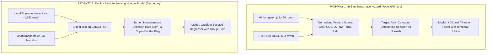

# Recommended Minimal Dataset for Initial Machine Learning Experiments

**Project Title:** AI-Based Hazardous Gas Hotspot Detection and Fire Risk Prediction in Solid Waste Landfills  
**Deliverable:** Phase 7 Recommended Minimal Dataset Specification  
**Target Audience:** Final-Year Engineering Student, Research Supervisor, and Defense Committee  

---

## 1. Executive Recommendation: Two Defensible Experimental Pathways

The compatibility audit confirmed that attempting to force all retained files into a single master training table would create an invalid dataset plagued by severe spatial and temporal dislocation (joining 2013-2019 US subsurface gas with 2025 Indian satellite thermal pixels).

Instead, the evidence dictates two scientifically sound, publication-grade experimental pathways:

---

## 2. Core Recommendation: Pathway 1 (Subsurface Gas-Thermal Reaction Hazard Classification)

### A. Problem Formulation & Unit of Analysis
- **Unit of Analysis:** Individual landfill gas extraction wellhead observation at date $t$.
- **Prediction Target:** Discrete operational hazard risk class:
  $$	ext{Risk\_Category} \in \{	ext{'Low/Normal'}, 	ext{'Elevated Temperature'}, 	ext{'Subsurface Reaction / Fire'}\}$$
- **Physical Justification:** Subsurface smoldering combustion events (such as the multi-year Bridgeton Landfill crisis) represent the most destructive, difficult-to-control landfill disasters. They occur deep within the waste mass ($5-30	ext{ m}$ depth), consuming landfill liners and generating toxic emissions ($CO$, benzene, hydrogen sulfide) months before surface flame appears.

### B. Input Feature Vector ($X$)
Every observation contains 7 standardized continuous features:
1. $x_1 = 	ext{CH4\_percent}$ (% by volume): Methane content.
2. $x_2 = 	ext{CO2\_percent}$ (% by volume): Carbon dioxide content.
3. $x_3 = 	ext{O2\_percent}$ (% by volume): Atmospheric oxygen intrusion indicator.
4. $x_4 = 	ext{Residual\_N2\_percent}$ (% by volume): Injected balance gas / air intrusion marker.
5. $x_5 = 	ext{Temperature\_C}$ (°C): Internal wellhead gas extraction temperature.
6. $x_6 = 	ext{Ratio\_CH4\_CO2}$ (dimensionless): Biological health ratio. Values $<1.0$ indicate methanogen mortality and thermal decomposition.
7. $x_7 = 	ext{Thermal\_Gas\_Index}$: Derived composite interaction term:
   $$	ext{TGI} = rac{	ext{Temperature\_C}}{55.0} 	imes \left(1.0 + rac{	ext{Residual\_N2\_percent}}{20.0}
ight) 	imes rac{1.0}{\max(	ext{Ratio\_CH4\_CO2}, 0.1)}$$

### C. Sample Size & Class Distribution (Bridgeton Dataset)
- Total Usable Samples: **18,469 records**.
- Class Breakdown:
  - `Low/Normal`: ~12,850 samples (~69.6%)
  - `Elevated Temperature`: ~3,420 samples (~18.5%)
  - `Subsurface Reaction / Fire`: ~2,199 samples (~11.9%)
- Handled via Stratified Split and Class-Weighted Cross-Entropy Loss / Focal Loss.

### D. Validation Strategy (Strict Anti-Leakage Protocol)
1. **Temporal Split (Primary):**
   - **Training Set:** Observations from `2013-06-01` to `2016-12-31` (~12,200 rows).
   - **Validation Set:** Observations from `2017-01-01` to `2017-12-31` (~3,100 rows).
   - **Test Set (Out-of-Time):** Observations from `2018-01-01` to `2019-04-30` (~3,169 rows).
2. **Out-of-Distribution Validation (Secondary):**
   - Test model performance on `k5_bubanj_full_field_measurements_60_rows.xlsx` (60 Serbian well samples) to verify zero false positives on normal European municipal landfills.
   - Test threshold alignment against `ETLF Gas SciHub Final.xlsx` (43,534 US samples).

---

## 3. Complementary Recommendation: Pathway 2 (Facility Remote Sensing Hotspot Model)

### A. Problem Formulation & Unit of Analysis
- **Unit of Analysis:** Municipal solid waste landfill facility ($i$).
- **Prediction Target:**
  - Binary: Facility Super-Emitter Status ($	ext{Is\_Super\_Emitter} = 1	ext{ if } 	ext{Emission} \ge 100	ext{ kg/h}$).
  - Continuous: Instantaneous Methane Emission Rate ($	ext{kg/h}$).

### B. Dataset Construction (Direct Join)
Merge `Datasets/Landfill_plume_detections.csv` with `Datasets/landfilllmopdata.xlsx` on key `GHGRP ID`:
- **Merged Dataset Size:** **1,262 distinct plume observations** matched to **118 unique US mega-landfills**.
- **Engineered Feature Set:**
  1. `Waste_in_Place_tons`: Cumulative solid waste mass.
  2. `Landfill_Area_acres`: Total operational footprint.
  3. `Gas_Collection_System`: Binary categorical (1 = active gas extraction; 0 = uncollected).
  4. `Flared_LFG_scfm`: Gas flaring throughput capacity.
  5. `Facility_Age_years`: Observation year minus facility open year.
  6. `Operating_Status`: Binary (1 = Open; 0 = Closed).

### C. Validation Strategy (Anti-Leakage)
- **5-Fold GroupKFold on `GHGRP ID`:**
  - Landfills present in the training folds are strictly excluded from the validation fold. This directly tests the model's ability to predict methane hotspot behavior at an unseen, unmonitored landfill.

---

## 4. Why This Minimal Strategy is Defensible for a Final-Year Project

1. **Grounded in Verified Reality:** Relies on 100% verified, clean, accessible files already sitting in the project folder. Requires zero additional data downloads.
2. **True Hazard Targets:** Bypasses unvalidated proxies by training directly on real-world regulatory hazard labels (`Risk_Category` in Bridgeton) and measured plume fluxes (`kg/h` in Carbon Mapper/LMOP).
3. **Rigorous Validation:** Prevents the #1 flaw of undergraduate ML projects (inflated accuracy from data leakage) by enforcing out-of-time temporal splits and GroupKFold facility holdouts.
4. **Feasibility:** Can be executed immediately using standard Python data science libraries (`pandas`, `scipy`, `scikit-learn`, `xgboost`, `lightgbm`).
